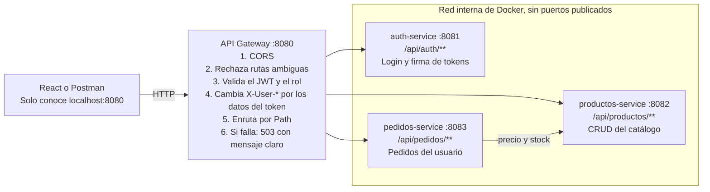

# API Gateway para microservicios: guía paso a paso (DSY1104)

Actualizada el 3 de noviembre de 2026.

## Objetivo

Al terminar esta guía tendrás una tienda de ejemplo con tres microservicios a los que se entra por una sola URL, `http://localhost:8080`, a través de un API Gateway con Spring Cloud Gateway.

La guía refuerza lo visto en DSY1103 y lo conecta con lo que exige DSY1104:

| Viene de DSY1103 | Se refuerza aquí | Se usa en DSY1104 |
| --- | --- | --- |
| Microservicios con Spring Boot y Maven | Separar servicios, cada uno con su propia base de datos | Backend de la tienda online |
| Comunicación REST entre servicios | `pedidos-service` consulta a `productos-service` con `RestClient` | Flujo de datos entre React y el backend |
| Pruebas con JUnit y Postman | Tests del gateway y colección de Postman | Pruebas de integración |
| CRUD con JPA | CRUD de productos protegido por roles | Autenticación con JWT y roles, y Swagger (Evaluación Parcial 3) |

El dominio es una tienda genérica, a propósito, para que no resuelva ninguno de los casos semestrales. El gateway es un refuerzo: las pautas de DSY1103 y DSY1104 revisadas no lo exigen como requisito.

## Qué es un API Gateway

Un API Gateway es la única puerta de entrada a un sistema de microservicios: recibe cada petición, aplica las reglas comunes y la envía al servicio que corresponde. Sin él, React tendría que conocer cada puerto y cada servicio repetiría la validación del token y la configuración de CORS.



La flecha entre pedidos y productos es la única comunicación interna: va directo, sin volver a pasar por el gateway.

Por ejemplo, cuando un cliente crea un pedido:

1. React envía `POST /api/pedidos` al puerto 8080 con el JWT en el header `Authorization`.
2. El gateway valida el token y descarta cualquier `X-User-*` que venga del cliente.
3. Agrega `X-User-Name` y `X-User-Roles` con los datos del token y reenvía a `pedidos-service`.
4. `pedidos-service` consulta precio y stock a `productos-service`.
5. Guarda el pedido y la respuesta vuelve a React por el mismo camino.

El gateway concentra lo transversal. La lógica de negocio, como el cálculo del total, sigue en cada microservicio.

## Requisitos y versiones

Necesitas Java 17 o superior y un editor; Docker Desktop o Docker Engine solo si usarás el camino con contenedores. Las versiones son las que entrega Spring Initializr a la fecha de esta guía.

| Componente | Versión |
| --- | --- |
| Spring Boot | 4.1.2 |
| Spring Cloud | 2025.1.4 |
| Java (nivel del proyecto) | 17 |
| springdoc-openapi | 3.2.0 |
| JJWT | 0.13.0 |

El ejemplo se probó de punta a punta con estas versiones, en Java 21 sobre Linux y en imágenes Docker con Java 17. No se probó en Windows ni en macOS.

**Atención con tutoriales antiguos.** En versiones anteriores la dependencia se llamaba `spring-cloud-starter-gateway` y las rutas iban bajo `spring.cloud.gateway.routes`. Aquí se usa `spring-cloud-starter-gateway-server-webmvc` y `spring.cloud.gateway.server.webmvc.routes`.

## Parte 1: los microservicios

Los tres servicios son proyectos Spring Boot independientes, cada uno con su `pom.xml`, su puerto y su base H2. Aquí está lo esencial de cada uno; el código completo está en este repositorio.

### Paso 1. Crear los proyectos

En [start.spring.io](https://start.spring.io) crea cada servicio con Maven, Java 17 y Spring Boot 4.1.2.

| Proyecto | Puerto | Dependencias en Initializr | Agregar a mano en `pom.xml` |
| --- | --- | --- | --- |
| `auth-service` | 8081 | Spring Web, Spring Data JPA, H2 Database, Validation, Spring Boot Actuator | springdoc, JJWT, `spring-security-crypto` |
| `productos-service` | 8082 | Las mismas | springdoc |
| `pedidos-service` | 8083 | Las mismas | springdoc |

Deja las carpetas juntas, una por servicio:

```text
fs2_api_gateway/
├── gateway/
├── auth-service/
├── productos-service/
├── pedidos-service/
├── pruebas/
└── docker-compose.yml
```

### Paso 2. Productos: un CRUD que no sabe de seguridad

Es un CRUD normal de DSY1103. La novedad es lo que no tiene: ni validación de token ni CORS, porque de eso se encarga el gateway.

```java
@RestController
@RequestMapping("/api/productos")
public class ProductoController {
    private final ProductoService service;

    public ProductoController(ProductoService service) {
        this.service = service;
    }

    @GetMapping
    public List<Producto> listar() {
        return service.listar();
    }

    @PostMapping
    @ResponseStatus(HttpStatus.CREATED)
    public Producto crear(@Valid @RequestBody Producto producto) {
        return service.crear(producto);
    }
    // buscar, actualizar y eliminar siguen el mismo patrón
}
```

### Paso 3. Auth: el único que firma tokens

`auth-service` guarda usuarios con la clave cifrada con BCrypt y entrega un JWT con el nombre y el rol. El registro siempre asigna el rol `CLIENTE`, así nadie puede registrarse como administrador.

```java
public String generar(Usuario usuario) {
    Instant ahora = Instant.now();
    return Jwts.builder()
            .issuer(issuer)
            .subject(usuario.getNombre())
            .claim("roles", List.of(usuario.getRol()))
            .issuedAt(Date.from(ahora))
            .expiration(Date.from(ahora.plus(duracion)))
            .signWith(key)
            .compact();
}
```

El secreto se lee de una variable de entorno y debe ser el mismo en `auth-service` y en el gateway:

```yaml
jwt:
  secret: ${JWT_SECRET:solo-desarrollo-local-cambiar-este-secreto-1234567890}
  issuer: tienda-auth
  expiracion-minutos: 30
```

### Paso 4. Pedidos: identidad por headers y llamada REST interna

`pedidos-service` no lee el JWT. Recibe el usuario en headers que el gateway agrega después de validar el token:

```java
@PostMapping
@ResponseStatus(HttpStatus.CREATED)
public Pedido crear(@RequestHeader("X-User-Name") String usuario,
                    @Valid @RequestBody NuevoPedido pedido) {
    return service.crear(usuario, pedido.productoId(), pedido.cantidad());
}
```

Para conocer el precio y el stock, llama directo a `productos-service`, sin pasar por el gateway. Define siempre un tiempo límite, para que una caída de productos no deje colgado a pedidos:

```java
SimpleClientHttpRequestFactory factory = new SimpleClientHttpRequestFactory();
factory.setConnectTimeout(Duration.ofSeconds(2));
factory.setReadTimeout(Duration.ofSeconds(3));
this.restClient = RestClient.builder().baseUrl(url).requestFactory(factory).build();
```

El pedido guarda solo `productoId`, sin clave foránea, porque la tabla de productos pertenece a otro servicio.

## Parte 2: el API Gateway

El gateway se construye en seis pasos: rutas, validación del token, reglas de acceso, registro de filtros, respuesta ante caídas y Swagger único.

### Paso 5. Crear el proyecto

En Initializr crea `gateway` con las dependencias **Gateway**, **Resilience4J** y **Spring Boot Actuator**. No elijas **Reactive Gateway**: usa WebFlux, un modelo distinto al de DSY1103. La opción **Gateway** corre sobre servlets, y por eso sus filtros son como los de cualquier aplicación Spring MVC.

Agrega a mano springdoc y JJWT. No agregues **Spring Web**; el starter del gateway ya la incluye.

```xml
<dependency>
  <groupId>org.springdoc</groupId>
  <artifactId>springdoc-openapi-starter-webmvc-ui</artifactId>
  <version>3.2.0</version>
</dependency>
<dependency>
  <groupId>io.jsonwebtoken</groupId>
  <artifactId>jjwt-api</artifactId>
  <version>0.13.0</version>
</dependency>
<dependency>
  <groupId>io.jsonwebtoken</groupId>
  <artifactId>jjwt-impl</artifactId>
  <version>0.13.0</version>
  <scope>runtime</scope>
</dependency>
<dependency>
  <groupId>io.jsonwebtoken</groupId>
  <artifactId>jjwt-jackson</artifactId>
  <version>0.13.0</version>
  <scope>runtime</scope>
</dependency>
```

### Paso 6. Declarar las rutas

Cada ruta dice qué peticiones atiende (`predicates`), a qué servicio van (`uri`) y qué se hace en el camino (`filters`). En `application.yml`:

```yaml
server:
  port: 8080

spring:
  cloud:
    gateway:
      server:
        webmvc:
          routes:
            - id: productos
              uri: ${PRODUCTOS_URL:http://localhost:8082}
              predicates:
                - Path=/api/productos/**
              filters:
                - name: CircuitBreaker
                  args:
                    id: productos
                    fallbackUri: forward:/fallback/productos
            # auth y pedidos siguen el mismo patrón

resilience4j:
  timelimiter:
    configs:
      default:
        timeout-duration: 5s
```

La URL del servicio va en una variable de entorno con un valor por defecto. Así el mismo código funciona en tu equipo (`localhost`) y en Docker (`productos-service`).

### Paso 7. Validar el JWT

El gateway no crea tokens, solo comprueba firma, emisor y expiración. Si algo falla, JJWT lanza una excepción y el usuario queda sin autenticar.

```java
public Optional<Usuario> validar(String token) {
    try {
        Claims claims = Jwts.parser()
                .verifyWith(key)
                .requireIssuer(issuer)
                .build()
                .parseSignedClaims(token)
                .getPayload();
        List<?> roles = claims.get("roles", List.class);
        return Optional.of(new Usuario(
                claims.getSubject(),
                roles == null ? List.of() : roles.stream().map(String::valueOf).toList()));
    } catch (JwtException | IllegalArgumentException e) {
        return Optional.empty();
    }
}
```

### Paso 8. Definir quién puede entrar a qué

La regla por defecto es exigir token: lo que no aparece en la tabla queda protegido, así un endpoint nuevo no nace abierto por olvido.

| Petición | Acceso |
| --- | --- |
| `POST /api/auth/login` y `POST /api/auth/registro` | Público |
| `GET` y `HEAD` en `/api/productos/**` | Público |
| Cualquier otro método en `/api/productos/**` | Solo `ADMIN` |
| Lectura de Swagger, `/docs/*` y `/actuator/health` | Público |
| Todo lo demás, incluido `/api/pedidos/**` | Requiere token |

El filtro aplica esa tabla antes de enrutar:

```java
String ruta = request.getRequestURI();
if (ReglasAcceso.esRutaSospechosa(ruta)) {
    error(response, 400, "Ruta no valida");
    return;
}

ReglasAcceso.Nivel nivel = ReglasAcceso.evaluar(request.getMethod(), ruta);
JwtValidator.Usuario usuario = extraerToken(request).flatMap(jwtValidator::validar).orElse(null);

if (nivel != ReglasAcceso.Nivel.PUBLICO && usuario == null) {
    response.setHeader(HttpHeaders.WWW_AUTHENTICATE, "Bearer");
    error(response, 401, "Token ausente, invalido o expirado");
    return;
}
if (nivel == ReglasAcceso.Nivel.ADMIN && !usuario.roles().contains("ADMIN")) {
    error(response, 403, "Se requiere el rol ADMIN");
    return;
}

Map<String, String> confiables = new HashMap<>();
if (usuario != null) {
    confiables.put(HEADER_USUARIO, usuario.nombre());
    confiables.put(HEADER_ROLES, String.join(",", usuario.roles()));
}
chain.doFilter(new RequestConHeaders(request, confiables), response);
```

Este filtro cierra dos ataques que conviene explicar en clase:

- **Suplantación.** Un cliente puede enviar `X-User-Name: admin` por su cuenta. `RequestConHeaders` descarta siempre esos headers y deja solo los que salen del token, incluso en rutas públicas.
- **Rutas ambiguas.** Una petición a `/api/productos/../pedidos` parece pública para el filtro, pero el servicio de destino podría interpretarla como `/api/pedidos`. Por eso se rechaza con 400 cualquier ruta con `..`, `;` o caracteres codificados sospechosos.

El código completo está en [`ReglasAcceso.java`](gateway/src/main/java/cl/duoc/tienda/gateway/ReglasAcceso.java) y [`SeguridadFilter.java`](gateway/src/main/java/cl/duoc/tienda/gateway/SeguridadFilter.java), que contiene `RequestConHeaders`.

### Paso 9. Registrar los filtros en orden

CORS debe correr primero. El navegador envía un preflight `OPTIONS` sin token, y si la seguridad lo atendiera antes respondería 401 y React vería un error de CORS.

```java
@Bean
FilterRegistrationBean<CorsFilter> corsFilter(@Value("${cors.allowed-origins}") List<String> origenes) {
    CorsConfiguration config = new CorsConfiguration();
    config.setAllowedOrigins(origenes);
    config.setAllowedMethods(List.of("GET", "POST", "PUT", "DELETE", "OPTIONS"));
    config.setAllowedHeaders(List.of("Authorization", "Content-Type"));
    config.setMaxAge(3600L);

    UrlBasedCorsConfigurationSource source = new UrlBasedCorsConfigurationSource();
    source.registerCorsConfiguration("/**", config);

    FilterRegistrationBean<CorsFilter> registro = new FilterRegistrationBean<>(new CorsFilter(source));
    registro.setOrder(Ordered.HIGHEST_PRECEDENCE);
    return registro;
}

@Bean
FilterRegistrationBean<SeguridadFilter> seguridadFilter(JwtValidator jwtValidator) {
    FilterRegistrationBean<SeguridadFilter> registro = new FilterRegistrationBean<>(new SeguridadFilter(jwtValidator));
    registro.setOrder(Ordered.HIGHEST_PRECEDENCE + 1);
    return registro;
}
```

CORS se configura solo en el gateway. Si un servicio también lo configura, la respuesta lleva el header duplicado y el navegador la rechaza.

### Paso 10. Responder bien cuando un servicio cae

El `CircuitBreaker` del Paso 6 reenvía a este controlador cuando el servicio no responde. Así el frontend recibe un 503 con un mensaje que puede mostrar.

```java
@RestController
public class FallbackController {

    @RequestMapping("/fallback/{servicio}")
    public ResponseEntity<Map<String, Object>> fallback(@PathVariable String servicio) {
        return ResponseEntity.status(HttpStatus.SERVICE_UNAVAILABLE).body(Map.of(
                "status", 503,
                "mensaje", "El servicio de " + servicio + " no esta disponible. Intenta nuevamente en unos minutos."));
    }
}
```

### Paso 11. Unificar Swagger

Cada servicio publica su documentación y el gateway las reúne en una sola página con un selector. Cada ruta de documentación apunta a un único recurso:

```yaml
- id: docs-productos
  uri: ${PRODUCTOS_URL:http://localhost:8082}
  predicates:
    - Path=/docs/productos
  filters:
    - SetPath=/v3/api-docs
```

```yaml
springdoc:
  swagger-ui:
    path: /swagger-ui.html
    urls:
      - name: productos
        url: /docs/productos
```

No uses aquí `Path=/docs/productos/**` con `StripPrefix`. Ese comodín dejaría llegar a cualquier endpoint del servicio por una ruta pública, saltándose la regla de `ADMIN`.

En cada servicio, `OpenApiConfig` declara `servers = @Server(url = "/")` para que **Try it out** pase por el gateway, y `@Parameter(hidden = true)` oculta en Swagger los headers `X-User-*`, porque los pone el gateway y no el usuario.

## Parte 3: ejecutar y probar

Con Docker Compose todo se levanta con un comando y solo el gateway queda accesible desde fuera. En el ejemplo, las 18 verificaciones del script pasaron tanto con Docker como sin él.

### Paso 12. Publicar solo el gateway

En `docker-compose.yml`, `ports` publica un puerto hacia tu equipo y `expose` lo deja solo en la red interna. Esta diferencia es la que da sentido a la arquitectura: si `pedidos-service` fuera público, cualquiera podría enviarle un `X-User-Name` falso.

```yaml
services:
  gateway:
    build: ./gateway
    ports:
      - "8080:8080"
    environment:
      JWT_SECRET: ${JWT_SECRET:?Copia .env.example a .env antes de levantar el proyecto}
      AUTH_URL: http://auth-service:8081
      PRODUCTOS_URL: http://productos-service:8082
      PEDIDOS_URL: http://pedidos-service:8083

  productos-service:
    build: ./productos-service
    expose:
      - "8082"
```

### Paso 13. Levantar y ejecutar las pruebas

Desde la carpeta del proyecto:

```bash
cp .env.example .env
docker compose up -d --build
./pruebas/probar.sh
```

La primera vez tarda varios minutos, porque descarga imágenes y dependencias. El script espera a que los servicios arranquen y debe terminar así:

```text
Resultado: 18 correctas, 0 fallidas
```

**Sin Docker:** abre una terminal por servicio y ejecuta `./mvnw spring-boot:run` en cada carpeta (en Windows, `mvnw.cmd spring-boot:run`). En este modo los puertos 8081 a 8083 quedan abiertos en tu equipo, así que sirve para desarrollar, no para demostrar el aislamiento.

### Paso 14. Probar a mano

Importa `pruebas/tienda.postman_collection.json` en Postman y ejecuta las peticiones en orden. Los dos logins guardan el token en variables de la colección. También puedes probar con Swagger en `http://localhost:8080/swagger-ui.html`, usando el botón **Authorize**.

| Prueba | Resultado esperado | Qué demuestra |
| --- | --- | --- |
| `GET /api/productos` sin token | 200 | Ruta pública |
| `GET /api/pedidos` sin token | 401 | Ruta protegida |
| `POST /api/productos` como cliente | 403 | Control por rol |
| `POST /api/productos` como admin | 201 | Acceso autorizado |
| `POST /api/pedidos` como cliente | 201 | Token, headers y llamada interna |
| Pedido con más unidades que el stock | 409, `Stock insuficiente` | El error del servicio llega al cliente |
| `GET /api/pedidos` con `X-User-Name: admin` falso | Solo pedidos propios | Suplantación bloqueada |
| `http://localhost:8082/api/productos` con Docker | Sin conexión | El servicio no está expuesto |

Los usuarios de demostración son `admin` / `admin12345` y `cliente` / `cliente12345`. Son solo para el laboratorio.

### Paso 15. Simular una caída

Detén el catálogo y consulta otra vez:

```bash
docker compose stop productos-service
curl -i http://localhost:8080/api/productos
```

Con el servicio detenido, la respuesta tardó cerca de 5 segundos, el límite configurado, y fue:

```json
{"mensaje":"El servicio de productos no esta disponible. Intenta nuevamente en unos minutos.","status":503}
```

Vuelve a levantarlo con `docker compose start productos-service`. El gateway volvió a responder 200 sin reiniciarse, unos 16 segundos después.

### Paso 16. Ejecutar los tests del gateway

```bash
cd gateway
./mvnw test
```

Son 15 tests. Levantan el gateway real contra un servicio simulado y comprueban el rechazo de tokens falsos y expirados, los roles, la suplantación, las rutas ambiguas, CORS y el fallback.

## Parte 4: conectar React

React solo necesita conocer la URL del gateway. Si mañana un servicio cambia de puerto o se divide en dos, el frontend no cambia.

En el archivo `.env` del proyecto Vite:

```text
VITE_API_URL=http://localhost:8080
```

Un único módulo concentra las llamadas y agrega el token:

```javascript
// src/api.js
const API_URL = import.meta.env.VITE_API_URL;

export async function api(ruta, opciones = {}) {
  const token = localStorage.getItem('token');
  const respuesta = await fetch(`${API_URL}${ruta}`, {
    ...opciones,
    headers: {
      'Content-Type': 'application/json',
      ...(token && { Authorization: `Bearer ${token}` }),
      ...opciones.headers,
    },
  });

  if (respuesta.status === 204) return null;
  const datos = await respuesta.json();
  if (!respuesta.ok) {
    // El gateway responde "mensaje"; los microservicios, "message"
    throw new Error(datos.mensaje ?? datos.message ?? 'Error inesperado');
  }
  return datos;
}
```

Uso desde un componente:

```javascript
const { token } = await api('/api/auth/login', {
  method: 'POST',
  body: JSON.stringify({ nombre, password }),
});
localStorage.setItem('token', token);

const productos = await api('/api/productos');
```

El gateway acepta por defecto el origen `http://localhost:5173`, el puerto habitual de Vite. Si tu frontend usa otro, cámbialo en `CORS_ORIGINS`. `localStorage` mantiene la sesión al recargar, pero un ataque XSS podría leerlo, así que justifica esa decisión si la usas en la Evaluación Parcial 3.

## Errores frecuentes

Las tres primeras filas ocurrieron de verdad al construir este ejemplo.

| Síntoma | Causa | Solución |
| --- | --- | --- |
| 504 en la primera petición a un servicio recién levantado | El `CircuitBreaker` corta a 1 segundo por defecto | Subir `resilience4j.timelimiter.configs.default.timeout-duration` |
| 504 en vez del fallback cuando un servicio cae | Se usó la forma corta `CircuitBreaker=id,forward:/...`, que no asignó la ruta de respaldo | Usar la forma larga, con `name` y `args`, del Paso 6 |
| Los errores no traen el texto, como `Stock insuficiente` | En Spring Boot 4 la propiedad vigente es otra | Usar `spring.web.error.include-message: always` |
| 401 con un token recién emitido | `JWT_SECRET` distinto en `auth-service` y en el gateway | Usar el mismo valor en ambos |
| `WeakKeyException` al arrancar | El secreto es demasiado corto | Usar al menos 32 caracteres |
| Error de CORS en el navegador | El origen no está en `CORS_ORIGINS`, o el filtro de seguridad corre antes que CORS | Revisar la variable y el orden del Paso 9 |
| `required variable JWT_SECRET is missing` | Falta el archivo `.env` | Ejecutar `cp .env.example .env` |
| 503 justo después de `docker compose up` | Los servicios siguen arrancando | Esperar unos segundos y reintentar |
| 404 desde el gateway | La ruta no coincide con ningún `Path` | Revisar el `Path` y el `@RequestMapping` del servicio |

## Actividades de reforzamiento

Estas actividades extienden el ejemplo y quedan sin resolver a propósito.

1. **Nuevo servicio.** Crea `resenas-service` en el puerto 8084, con su ruta, su fallback y su entrada en Swagger y en Docker Compose. Lectura pública; crear reseñas requiere token.
2. **Renovar tokens.** Agrega `POST /api/auth/refresh`. La Evaluación Parcial 3 pide generación, verificación y renovación de JWT, y este ejemplo solo cubre las dos primeras.
3. **Descontar stock.** Hoy el pedido revisa el stock, pero no lo descuenta. Impleméntalo y explica qué pasa si productos descuenta y luego falla el guardado del pedido.
4. **Base de datos real.** Cambia H2 por MySQL con una base por servicio, y agrega los contenedores a Docker Compose.
5. **Nuevo rol.** Agrega el rol `VENDEDOR`, que puede modificar productos pero no eliminarlos, y cubre la regla con un test.
6. **Despliegue.** Publica el proyecto en AWS EC2 con un secreto propio y abre en el grupo de seguridad solo el puerto del gateway.

### Preguntas de comprensión

1. ¿Qué tendría que repetir cada microservicio si no existiera el gateway?
2. ¿Por qué `pedidos-service` puede confiar en `X-User-Name`? ¿Qué condición de despliegue debe cumplirse?
3. ¿Por qué `pedidos-service` llama directo a `productos-service` y no a través del gateway? ¿Qué se gana y qué se pierde?
4. ¿Cuál es la diferencia entre un 401 y un 403? Da un ejemplo de cada uno en este sistema.
5. ¿Por qué el filtro de CORS debe correr antes que el de seguridad?
6. El gateway es un punto único de entrada. ¿Qué riesgo introduce y cómo lo mitigarías?
7. ¿Qué problema de seguridad causaría una ruta `/docs/productos/**` con `StripPrefix`?
